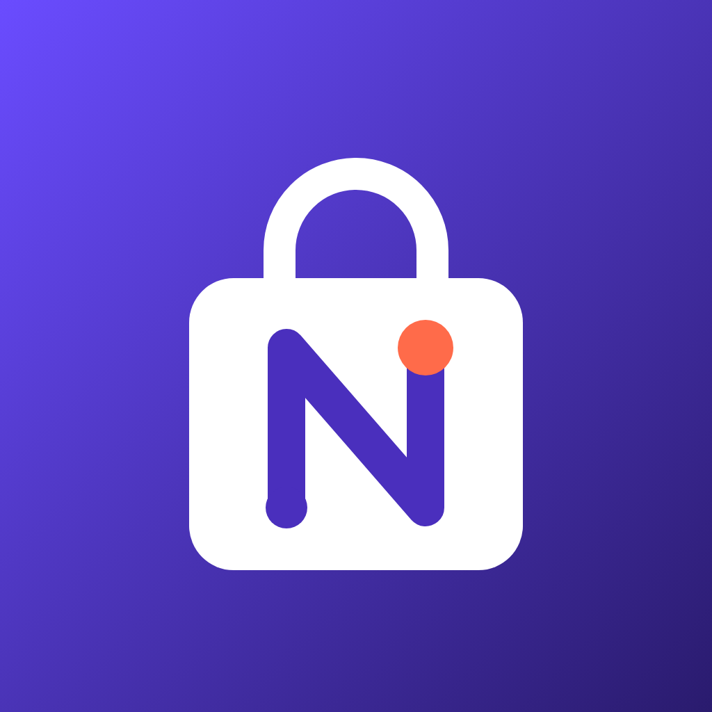
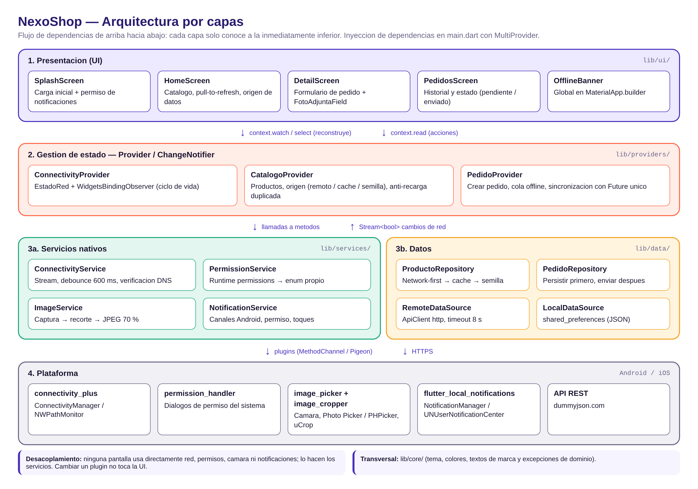
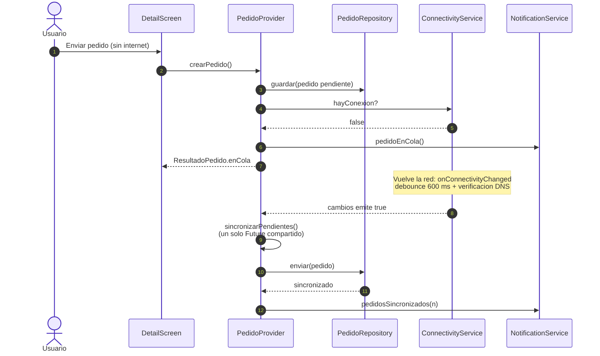

<p align="center">
  
</p>

<h1 align="center">NexoShop</h1>
<p align="center"><b>Tu tienda conectada, incluso sin conexión.</b><br/>
Catálogo móvil de productos en Flutter con modo offline, cámara y notificaciones locales.</p>

<p align="center">
  
  
  
  
  
</p>

---

> **Actividad Integradora 2: Reingeniería, servicios nativos y auditoría de código.**
> Este proyecto **es la evolución de la app de la Actividad Integradora 1** ("Mi Catálogo").
> El historial de commits empieza con el proyecto original (`5db3fc7`) para que se pueda auditar cada cambio.

## Tabla de contenido

1. [Qué hay de nuevo](#qué-hay-de-nuevo-v1--v2)
2. [Funcionalidades](#funcionalidades)
3. [Arquitectura](#arquitectura)
4. [Estructura de carpetas](#estructura-de-carpetas)
5. [Requisitos](#requisitos)
6. [Instalación y ejecución](#instalación-y-ejecución)
7. [Permisos nativos](#permisos-nativos)
8. [Cómo probar cada servicio (QA)](#cómo-probar-cada-servicio-qa)
9. [Flujo de trabajo con Git](#flujo-de-trabajo-con-git)
10. [Solución de problemas](#solución-de-problemas)
11. [Autor](#autor)

## Qué hay de nuevo (v1 → v2)

| Aspecto | Actividad 1: *Mi Catálogo* | Actividad 2: **NexoShop** |
|---|---|---|
| Nombre visible | Mi Catalogo / Catalogo App | **NexoShop** |
| Package / Bundle ID | `com.catalogo.catalogo_app` / `com.catalogo.catalogoApp` | **`ec.nexoshop.app`** |
| Ícono | Ícono por defecto de Flutter | Ícono propio (adaptativo en Android 8+, AppIcon iOS) |
| Splash | Pantalla blanca | Splash nativo de marca (Android < 12, Splash API 12+, iOS) + splash animado en Flutter |
| Colores | `Colors.blue` repetido en cada pantalla | Paleta única `AppColors` + `AppTheme` (Material 3) |
| Datos | Lista fija en el código | API REST + caché local + catálogo semilla |
| Arquitectura | 1 carpeta de pantallas | Capas: UI → Provider → Servicios / Repositorios → Plataforma |
| Red | — | Detección reactiva (Stream) + banner offline + cola de pedidos |
| Cámara | — | Cámara/galería, permisos en tiempo de ejecución, recorte y compresión |
| Notificaciones | — | Notificaciones locales con canales Android e iOS |

## Funcionalidades

**Conectividad en tiempo real.**
- `ConnectivityService` escucha `onConnectivityChanged` (connectivity_plus) y expone un `Stream<bool>`.
- Además de mirar la interfaz de red, verifica que haya **internet real** con una consulta DNS, porque un Wi-Fi conectado no garantiza salida a internet.
- Un **banner flotante global** avisa "Sin conexión" y luego "Conexión restablecida".
- **Caché**: el catálogo se guarda en `shared_preferences` y las imágenes en disco (`cached_network_image`).
- **Cola offline**: los pedidos hechos sin red se guardan en el teléfono y se envían solos al volver la conexión.

**Cámara, galería y permisos.**
- Antes del diálogo del sistema se muestra uno propio que explica para qué se usa la cámara.
- Cada respuesta del usuario tiene su manejo: concedido; denegado (SnackBar con "Reintentar"); **denegado permanentemente** (diálogo que lleva a "Abrir ajustes"); restringido.
- La foto pasa por **recorte** nativo (uCrop / TOCropViewController) y **compresión** a JPEG 70 % con máximo 1080 px. La app muestra el tamaño antes y después.
- La galería no pide permisos: usa el Photo Picker de Android 13+ y PHPicker de iOS (principio de mínimo privilegio).
- Si Android destruye la app mientras la cámara está abierta, la foto se recupera con `retrieveLostData()`.

**Notificaciones locales.**
- Dos canales Android: `nexo_pedidos` (importancia alta) y `nexo_conectividad` (importancia baja).
- Avisos ante eventos clave: pedido confirmado, pedido guardado sin conexión, pedidos sincronizados, y pérdida o recuperación de red cuando la app está en segundo plano.
- Al tocar una notificación se abre **Mis pedidos**, tanto con la app abierta como con la app cerrada.

## Arquitectura



- **UI (`lib/ui`)**: solo widgets. Lee estado con `context.watch/select` y dispara acciones con `context.read`.
- **Estado (`lib/providers`)**: `ChangeNotifier` + `provider`. Coordina servicios y repositorios.
- **Servicios nativos (`lib/services`)**: cada uno envuelve un plugin y expone una API propia (enums, streams y excepciones de dominio). Ninguna pantalla llama directamente a un plugin de red, permisos, cámara o notificaciones.
- **Datos (`lib/data`)**: repositorios con estrategia *network-first, cache fallback*, más fuentes remota y local.
- **Inyección de dependencias** manual en `main.dart` con `MultiProvider`.

Flujo de un pedido sin conexión:



## Estructura de carpetas

```
lib/
├── main.dart                     # Composición de dependencias + MultiProvider
├── app.dart                      # MaterialApp, rutas, banner global, toques de notificación
├── core/
│   ├── constants/app_strings.dart
│   ├── errors/app_exceptions.dart
│   └── theme/ app_colors.dart · app_theme.dart
├── data/
│   ├── models/ producto.dart · pedido.dart
│   ├── datasources/ api_client.dart · remote_datasource.dart · local_datasource.dart
│   └── repositories/ producto_repository.dart · pedido_repository.dart
├── services/
│   ├── connectivity_service.dart
│   ├── permission_service.dart
│   ├── image_service.dart
│   └── notification_service.dart
├── providers/
│   ├── connectivity_provider.dart
│   ├── catalogo_provider.dart
│   └── pedido_provider.dart
└── ui/
    ├── screens/ splash · home · detail · pedidos
    └── widgets/ offline_banner · foto_adjunta_field · producto_card · producto_imagen · origen_datos_chip
assets/branding/                  # Ícono fuente (SVG), PNG 1024 y logo del splash
docs/                             # Diagramas e informe técnico (PDF)
test/                             # Pruebas unitarias
```

## Requisitos

- Flutter estable con **Dart ≥ 3.12** (el proyecto usa `sdk: ^3.12.0`)
- Android Studio con un emulador **API 33+**, para probar los permisos de notificación y el Photo Picker
- Xcode 16+ para iOS (opcional)

## Instalación y ejecución

```bash
git clone https://github.com/<tu-usuario>/nexoshop.git
cd nexoshop
flutter pub get
flutter run                 # en el emulador o dispositivo conectado
flutter test                # pruebas unitarias
flutter build apk --release # APK de distribución
```

> La primera vez que se ejecuta, la app descarga el catálogo desde `https://dummyjson.com` (API pública de pruebas). Si no hay internet, muestra la caché o el catálogo semilla.

## Permisos nativos

| Permiso | Plataforma | Dónde | Cuándo se pide |
|---|---|---|---|
| `INTERNET`, `ACCESS_NETWORK_STATE` | Android | `AndroidManifest.xml` | Instalación (normales) |
| `CAMERA` | Android | `AndroidManifest.xml` | Al tocar **Cámara** (runtime) |
| `POST_NOTIFICATIONS` | Android 13+ | `AndroidManifest.xml` | En el splash (runtime) |
| `NSCameraUsageDescription` | iOS | `Info.plist` | Al tocar **Cámara** |
| `NSPhotoLibraryUsageDescription` | iOS | `Info.plist` | Al usar la galería |
| Notificaciones | iOS | `AppDelegate.swift` | En el splash |

## Cómo probar cada servicio (QA)

| Caso | Pasos | Resultado esperado |
|---|---|---|
| Modo offline | Abrir la app con internet y luego activar el modo avión | Banner "Sin conexión"; el catálogo sigue visible con el chip "Mostrando copia guardada" |
| Pedido offline | Sin internet, enviar un pedido | Diálogo "Pedido guardado", notificación "Pedido guardado sin conexión" y badge en Mis pedidos |
| Sincronización | Desactivar el modo avión | Banner "Conexión restablecida", notificación "Pedidos sincronizados" y estado "Enviado" |
| Permiso concedido | Detalle → Cámara → Continuar → Permitir | Se abre la cámara, luego el recorte y la previsualización con tamaño comprimido |
| Permiso denegado | Rechazar el permiso | SnackBar con "Reintentar" |
| Denegado permanente | Rechazar dos veces (Android) | Diálogo "Permiso bloqueado" → "Abrir ajustes" |
| Notificación desde segundo plano | Enviar la app al fondo y cortar la red | Notificación "Sin conexión" en el canal *Estado de conexión* |
| Toque en notificación | Tocar cualquier notificación | Se abre *Mis pedidos* |

> En el emulador de Android la cámara trasera es una escena virtual; se configura en *AVD Manager → Advanced → Camera*.

## Flujo de trabajo con Git

Se usa un modelo **Git Flow simplificado**:

```
main ──●──●──●───────────────────────────────────────●  (v1.1.0 rebranding · v2.0.0 release)
        \                                           /
develop  ●────●──────●──────●──────●──────●────────●
               \    / \    / \    / \    /
feature/arquitectura-capas · feature/conectividad · feature/camara-permisos · feature/notificaciones
```

| Rama | Propósito |
|---|---|
| `main` | Versión estable. Contiene el rebranding (tag `v1.1.0`) y la release final (tag `v2.0.0`) |
| `develop` | Integración de funcionalidades |
| `feature/arquitectura-capas` | Refactor a capas + Provider + caché |
| `feature/conectividad` | Servicio de red reactivo, banner y cola offline |
| `feature/camara-permisos` | Cámara, galería, permisos, recorte y compresión |
| `feature/notificaciones` | Notificaciones locales y canales |

Los commits siguen **Conventional Commits** (`feat`, `refactor`, `test`, `docs`, `chore`) con alcance (`branding`, `red`, `camara`...). Las ramas se integran con `--no-ff` para conservar la trazabilidad.

```bash
git log --oneline --graph --all   # ver el historial completo
```

## Solución de problemas

- **`compileSdk` / AAR metadata**: si Gradle pide un `compileSdk` mayor, en `android/app/build.gradle.kts` reemplaza `compileSdk = flutter.compileSdkVersion` por el número que indica el error (por ejemplo `36`).
- **iOS con CocoaPods** (si el proyecto genera un `ios/Podfile`): `permission_handler` necesita habilitar la cámara en el `post_install` del Podfile:
  ```ruby
  target.build_configurations.each do |config|
    config.build_settings['GCC_PREPROCESSOR_DEFINITIONS'] ||= ['$(inherited)', 'PERMISSION_CAMERA=1', 'PERMISSION_PHOTOS=1']
  end
  ```
  Con Swift Package Manager (la configuración actual) basta con que existan las claves `NS*UsageDescription` en `Info.plist`.
- **Desugaring**: `flutter_local_notifications` requiere `isCoreLibraryDesugaringEnabled = true`. Ya está configurado.

## Autor

**Jefferson Ricardo Vera Macas**. Desarrollo de Aplicaciones Móviles, Actividad Integradora 2.
